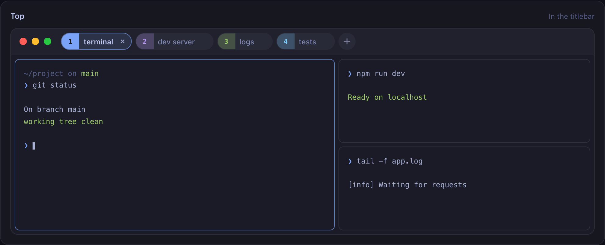
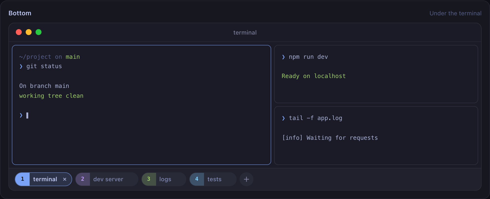
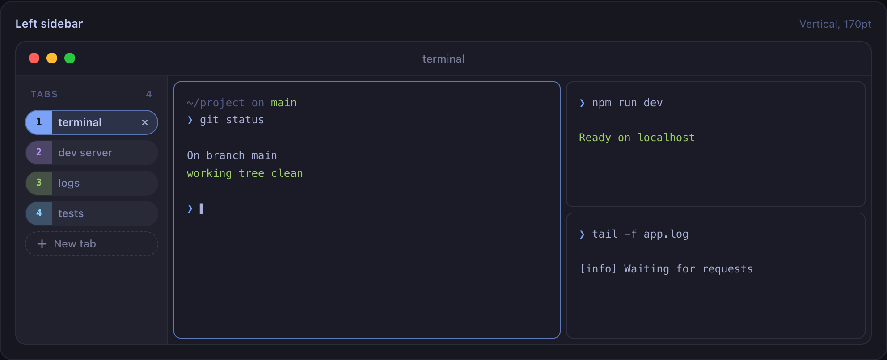
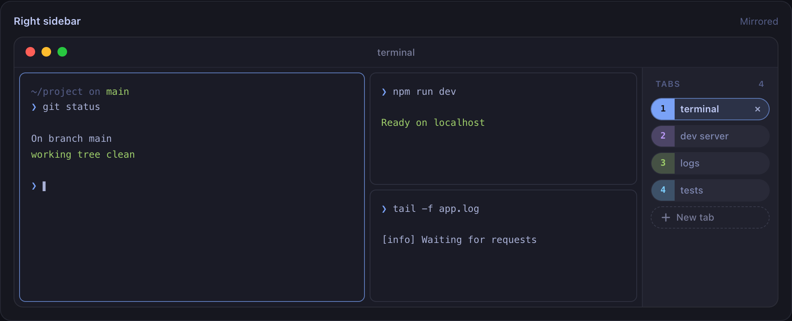
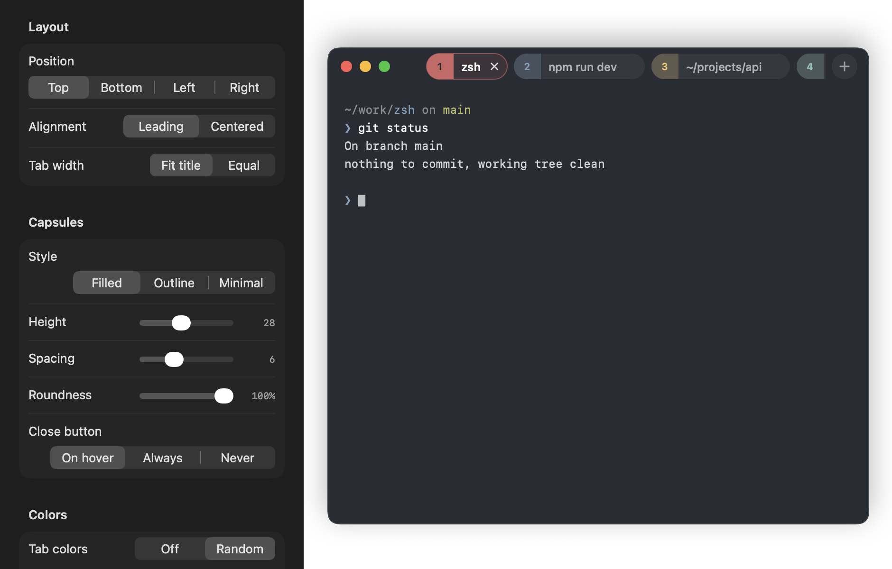

# Ghostty X

Ghostty X is a personal macOS appearance fork of Ghostty with a new rounded
tab design, theme-matched colors, and rounded split panes.

## Terminal UI and split panes

Four tab layouts, each shown with a large terminal pane beside two stacked
panes. Select a position in **Tab Bar… → Position** to use it in the app.

| Top tabs | Bottom tabs |
| --- | --- |
|  |  |
| Tabs share the titlebar above the terminal. | Tabs sit below the terminal content. |

| Left sidebar | Right sidebar |
| --- | --- |
|  |  |
| Vertical tabs on the left, with an adjustable sidebar width. | The mirrored layout with vertical tabs on the right. |

*These are renders of the local HTML design preview with sample terminal
content, not screenshots of a running native terminal.*

[Download the interactive HTML preview](docs/previews/tab-bar-redesign.html)
and open it in a browser to try all four positions, tab styles, colors, and
sizing controls. The preview is self-contained and works locally.

### What changed

| Area | Ghostty X changes |
| --- | --- |
| Tabs | Rounded capsules with selection and hover effects, theme accents, and optional per-tab color caps, tints, or dots. |
| Tab placement | Top titlebar, bottom bar, or left/right sidebar. |
| Tab controls | A custom visible strip for selecting, renaming, closing, reordering, and detaching native tabs; scrollable overflow keeps the selected tab visible. |
| Split panes | Eight-point rounded corners, six-point gaps between panes, and six-point padding around a split layout. |
| Focus | The active split pane gets a blue outline; other panes have a subtle border. |
| Split resizing | Divider calculations include the full gap, and dragging uses translation to avoid an initial jump. |
| Gutter appearance | Gaps use the terminal background color and configured opacity. |
| Appearance settings | A dedicated **Tab Bar…** window with an interactive preview and settings that apply live. |
| App identity | Builds as `GhosttyX.app` with bundle identifier `com.amsynist.ghosttyx`. |

Horizontal, vertical, and nested splits continue to use Ghostty's split tree.
Existing pane drag/drop, zoom, equalize, and keyboard actions are retained.
The terminal engine, themes, fonts, and key bindings continue to use Ghostty.

The custom tab strip requires macOS 26 or later and the `tabs` titlebar style.
macOS 13–15 retains the upstream tab appearance.

### Tab appearance preview



*Rendered settings fixture using the actual tab component and sample content.*

### Still to add or verify

- Add screenshots of a running terminal with horizontal, vertical, and nested
  splits; the four layouts above are currently HTML illustrations.
- Complete real-window checks for fullscreen, session restoration, tab overflow,
  close confirmation, split resizing, and physical mouse/keyboard input.
- Make the documented `ReleaseLocal` test invocation work with Swift test
  imports: the latest attempt stopped before tests ran because the app module
  was built without `-enable-testing`.
- Pane corner radius, gutter width, and focus-outline appearance are currently
  fixed in code. User-facing controls for these would be a future addition;
  **Tab Bar…** currently customizes tabs only.

## Configuration

Add this to your existing Ghostty configuration to enable the custom tabs:

```ini
macos-titlebar-style = tabs
```

Open **Tab Bar…** beside **Open Config** in the app menu to customize the
appearance with a live preview. Settings apply to all windows immediately
and are saved in the app's preferences, separately from the Ghostty config.

| Setting | Options |
| --- | --- |
| Position | Top, bottom, left, right |
| Style | Filled, outline, minimal |
| Width and alignment | Fit title or equal width; leading or centered |
| Dimensions | Tab height, spacing, roundness, sidebar width |
| Close button | On hover, always, never |
| Colors | Theme accent, random tab colors, color indicators, shuffle |
| Details | Tab numbers, bar background, visibility with a single tab |

Terminal themes, fonts, and key bindings continue to use the existing Ghostty
configuration. Use **Restore defaults** in the Tab Bar window to reset its
appearance settings.

The app builds as `GhosttyX.app` with bundle identifier
`com.amsynist.ghosttyx`. See [Ghostty X build and implementation notes](GHOSTTY_X.md)
for build commands, tests, and validation details.

---

<!-- LOGO -->
<h1>
<p align="center">
  
  <br>Ghostty
</h1>
  <p align="center">
    Fast, native, feature-rich terminal emulator pushing modern features.
    <br />
    A native GUI or embeddable library via <code>libghostty</code>.
    <br />
    <a href="#about">About</a>
    ·
    <a href="https://ghostty.org/download">Download</a>
    ·
    <a href="https://ghostty.org/docs">Documentation</a>
    ·
    <a href="CONTRIBUTING.md">Contributing</a>
    ·
    <a href="HACKING.md">Developing</a>
  </p>
</p>

## About

Ghostty is a terminal emulator that differentiates itself by being
fast, feature-rich, and native. While there are many excellent terminal
emulators available, they all force you to choose between speed,
features, or native UIs. Ghostty provides all three.

**`libghostty`** is a cross-platform, zero-dependency C and Zig library
for building terminal emulators or utilizing terminal functionality
(such as style parsing). Anyone can use `libghostty` to build a terminal
emulator or embed a terminal into their own applications. See
[Ghostling](https://github.com/ghostty-org/ghostling) for a minimal complete project
example or the [`examples` directory](https://github.com/ghostty-org/ghostty/tree/main/example)
for smaller examples of using `libghostty` in C and Zig.

For more details, see [About Ghostty](https://ghostty.org/docs/about).

## Download

See the [download page](https://ghostty.org/download) on the Ghostty website.

## Documentation

See the [documentation](https://ghostty.org/docs) on the Ghostty website.

## Contributing and Developing

If you have any ideas, issues, etc. regarding Ghostty, or would like to
contribute to Ghostty through pull requests, please check out our
["Contributing to Ghostty"](CONTRIBUTING.md) document. Those who would like
to get involved with Ghostty's development as well should also read the
["Developing Ghostty"](HACKING.md) document for more technical details.

## Roadmap and Status

Ghostty is stable and in use by millions of people and machines daily.

The high-level ambitious plan for the project, in order:

|  #  | Step                                                    | Status |
| :-: | ------------------------------------------------------- | :----: |
|  1  | Standards-compliant terminal emulation                  |   ✅   |
|  2  | Competitive performance                                 |   ✅   |
|  3  | Rich windowing features -- multi-window, tabbing, panes |   ✅   |
|  4  | Native Platform Experiences                             |   ✅   |
|  5  | Cross-platform `libghostty` for Embeddable Terminals    |   ✅   |
|  6  | Ghostty-only Terminal Control Sequences                 |   ❌   |

Additional details for each step in the big roadmap below:

#### Standards-Compliant Terminal Emulation

Ghostty implements all of the regularly used control sequences and
can run every mainstream terminal program without issue. For legacy sequences,
we've done a [comprehensive xterm audit](https://github.com/ghostty-org/ghostty/issues/632)
comparing Ghostty's behavior to xterm and building a set of conformance
test cases.

In addition to legacy sequences (what you'd call real "terminal" emulation),
Ghostty also supports more modern sequences than almost any other terminal
emulator. These features include things like the Kitty graphics protocol,
Kitty image protocol, clipboard sequences, synchronized rendering,
light/dark mode notifications, and many, many more.

We believe Ghostty is one of the most compliant and feature-rich terminal
emulators available.

Terminal behavior is partially a de jure standard
(i.e. [ECMA-48](https://ecma-international.org/publications-and-standards/standards/ecma-48/))
but mostly a de facto standard as defined by popular terminal emulators
worldwide. Ghostty takes the approach that our behavior is defined by
(1) standards, if available, (2) xterm, if the feature exists, (3)
other popular terminals, in that order. This defines what the Ghostty project
views as a "standard."

#### Competitive Performance

Ghostty is generally in the same performance category as the other highest
performing terminal emulators.

"The same performance category" means that Ghostty is much faster than
traditional or "slow" terminals and is within an unnoticeable margin of the
well-known "fast" terminals. For example, Ghostty and Alacritty are usually within
a few percentage points of each other on various benchmarks, but are both
something like 100x faster than Terminal.app and iTerm. However, Ghostty
is much more feature rich than Alacritty and has a much more native app
experience.

This performance is achieved through high-level architectural decisions and
low-level optimizations. At a high-level, Ghostty has a multi-threaded
architecture with a dedicated read thread, write thread, and render thread
per terminal. Our renderer uses OpenGL on Linux and Metal on macOS.
Our read thread has a heavily optimized terminal parser that leverages
CPU-specific SIMD instructions. Etc.

#### Rich Windowing Features

The Mac and Linux (build with GTK) apps support multi-window, tabbing, and
splits with additional features such as tab renaming, coloring, etc. These
features allow for a higher degree of organization and customization than
single-window terminals.

#### Native Platform Experiences

Ghostty is a cross-platform terminal emulator but we don't aim for a
least-common-denominator experience. There is a large, shared core written
in Zig but we do a lot of platform-native things:

- The macOS app is a true SwiftUI-based application with all the things you
  would expect such as real windowing, menu bars, a settings GUI, etc.
- macOS uses a true Metal renderer with CoreText for font discovery.
- macOS supports AppleScript, Apple Shortcuts (AppIntents), etc.
- The Linux app is built with GTK.
- The Linux app integrates deeply with systemd if available for things
  like always-on, new windows in a single instance, cgroup isolation, etc.

Our goal with Ghostty is for users of whatever platform they run Ghostty
on to think that Ghostty was built for their platform first and maybe even
exclusively. We want Ghostty to feel like a native app on every platform,
for the best definition of "native" on each platform.

#### Cross-platform `libghostty` for Embeddable Terminals

In addition to being a standalone terminal emulator, Ghostty is a
C-compatible library for embedding a fast, feature-rich terminal emulator
in any 3rd party project. This library is called `libghostty`.

Due to the scope of this project, we're breaking libghostty down into
separate libraries, starting with `libghostty-vt`. The goal of
this project is to focus on parsing terminal sequences and maintaining
terminal state. This is covered in more detail in this
[blog post](https://mitchellh.com/writing/libghostty-is-coming).

`libghostty-vt` is already available and usable today for Zig and C and
is compatible for macOS, Linux, Windows, and WebAssembly. The functionality
is extremely stable (since its been proven in Ghostty GUI for a long time),
but the API signatures are still in flux.

`libghostty` is already heavily in use. See [`examples`](https://github.com/ghostty-org/ghostty/tree/main/example)
for small examples of using `libghostty` in C and Zig or the
[Ghostling](https://github.com/ghostty-org/ghostling) project for a
complete example. See [awesome-libghostty](https://github.com/Uzaaft/awesome-libghostty)
for a list of projects and resources related to `libghostty`.

`libghostty-vt` is released on its own, separately from Ghostty, with
`vt-X.Y.Z` tags. To build or package it, see
[`PACKAGING-LIBGHOSTTY.md`](PACKAGING-LIBGHOSTTY.md). To use it from a
CMake project, see [`dist/cmake/README.md`](dist/cmake/README.md). We're
still working on a better docs experience, but our
[Doxygen website](https://libghostty.tip.ghostty.org/) is a good resource
for the C API.

#### Ghostty-only Terminal Control Sequences

We want and believe that terminal applications can and should be able
to do so much more. We've worked hard to support a wide variety of modern
sequences created by other terminal emulators towards this end, but we also
want to fill the gaps by creating our own sequences.

We've been hesitant to do this up until now because we don't want to create
more fragmentation in the terminal ecosystem by creating sequences that only
work in Ghostty. But, we do want to balance that with the desire to push the
terminal forward with stagnant standards and the slow pace of change in the
terminal ecosystem.

We haven't done any of this yet.

## Crash Reports

Ghostty has a built-in crash reporter that will generate and save crash
reports to disk. The crash reports are saved to the `$XDG_STATE_HOME/ghostty/crash`
directory. If `$XDG_STATE_HOME` is not set, the default is `~/.local/state`.
**Crash reports are _not_ automatically sent anywhere off your machine.**

Crash reports are only generated the next time Ghostty is started after a
crash. If Ghostty crashes and you want to generate a crash report, you must
restart Ghostty at least once. You should see a message in the log that a
crash report was generated.

> [!NOTE]
>
> Use the `ghostty +crash-report` CLI command to get a list of available crash
> reports. A future version of Ghostty will make the contents of the crash
> reports more easily viewable through the CLI and GUI.

Crash reports end in the `.ghosttycrash` extension. The crash reports are in
[Sentry envelope format](https://develop.sentry.dev/sdk/envelopes/). You can
upload these to your own Sentry account to view their contents, but the format
is also publicly documented so any other available tools can also be used.
The `ghostty +crash-report` CLI command can be used to list any crash reports.
A future version of Ghostty will show you the contents of the crash report
directly in the terminal.

To send the crash report to the Ghostty project, you can use the following
CLI command using the [Sentry CLI](https://docs.sentry.io/cli/installation/):

```shell-session
SENTRY_DSN=https://e914ee84fd895c4fe324afa3e53dac76@o4507352570920960.ingest.us.sentry.io/4507850923638784 sentry-cli send-envelope --raw <path to ghostty crash>
```

> [!WARNING]
>
> The crash report can contain sensitive information. The report doesn't
> purposely contain sensitive information, but it does contain the full
> stack memory of each thread at the time of the crash. This information
> is used to rebuild the stack trace but can also contain sensitive data
> depending on when the crash occurred.
